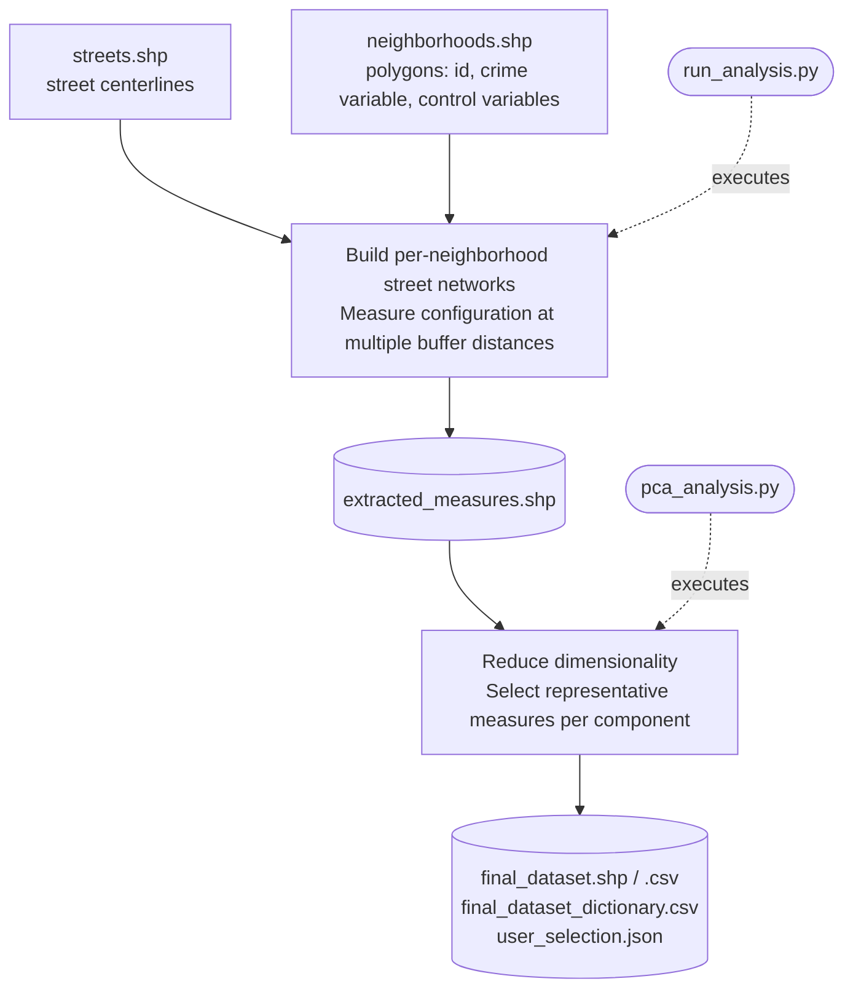
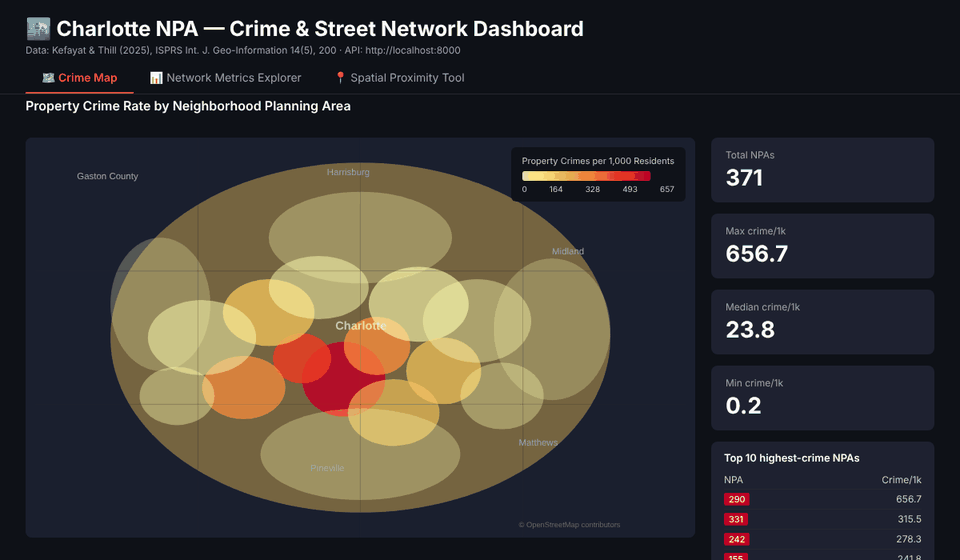

# Street Network Configuration and Property Crime: data pipeline

> **Under construction.** This branch (`data-service`) extends the pipeline with a data service: a PostGIS database, a REST API and an interactive dashboard. It currently serves the Charlotte case study only; the plan is to generalize it so that the dataset built by the pipeline for any city can be loaded and explored. The stable, pipeline-only version is on [`master`](https://github.com/Erfankt/urban-network-analysis).

Reproducible data-construction pipeline for the paper

> Kefayat, E., & Thill, J.-C. (2025). *Urban Street Network Configuration and Property Crime: An Empirical Multivariate Case Study.* ISPRS International Journal of Geo-Information, 14(5), 200. https://doi.org/10.3390/ijgi14050200

Starting from a cleaned street centerline layer and a set of neighborhood polygons, the pipeline builds the neighborhood-level street networks, measures their configuration at different nested spatial scales, reduces the dimensionality, and writes a modeling-ready dataset.


The pipeline has two front ends over the same code: the terminal scripts described below, and a **web interface** (`app/`, see *Web interface*).

## Workflow



## Setup

Python 3.11 is recommended (implemented version in the paper). The dependencies live in a virtual environment, `.venv`, in the repository folder. There are three ways to set it up.

**1. Quickest start (double-click)**

1. Install Python 3.11.
2. Double-click `start_app.bat` (Windows) or `start_app.command` (macOS/Linux). On macOS/Linux, make it executable first: `chmod +x start_app.command`.
3. The launcher creates `.venv`, installs Streamlit, and opens your browser. Its window closes by itself (Windows) or can be closed. The page's **0 · Setup** section installs the remaining packages.
4. To stop the app, close the browser tab, the server shuts down after about 30 seconds. To keep it running, add `KEEP_RUNNING=1` to a `.env` file in the repository folder before launching.

**2. From the web interface (Streamlit)**

1. Create the virtual environment from the repository folder:
   ```bash
   python -m venv .venv
   ```
2. Activate it (step 2 in option 3 below), then install Streamlit and start the app:
   ```bash
   pip install streamlit
   streamlit run app/streamlit_app.py
   ```
3. The app opens and navigates to **0 · Setup**.

**3. From the terminal**

1. Create the virtual environment:
   ```bash
   python -m venv .venv
   ```
2. Activate it:
   ```bash
   # Windows, Command Prompt:   .venv\Scripts\activate
   # Windows, PowerShell:       .venv\Scripts\Activate.ps1
   # macOS / Linux:             source .venv/bin/activate
   ```
3. Install the dependencies:
   ```bash
   pip install -r requirements.txt
   ```
4. You are ready. See **Stage 1** and **Stage 2** below to run the analysis.

> **Note:** To check if an existing environment is complete, activate it and run `python -c "import geopandas, networkx, scipy, tqdm, factor_analyzer, matplotlib, seaborn, folium, sklearn; print(sklearn.__version__)"` — if it prints a version, skip step 3. A `check_array() got an unexpected keyword argument 'force_all_finite'` error means the script is running outside `.venv` with scikit-learn 1.8+; activate the environment and retry. Jupyter is only needed for the notebook version of stage 2. The Streamlit packages at the end of `requirements.txt` are only needed for the web interface.

## Input data

The default locations are below and data should be located within the directory below. The streets layer can be in any projected CRS (feet or metres) or latitude/longitude. The pipeline converts units automatically. If the neighborhoods layer is in a different CRS, it is reprojected to match the streets layer. The setup validates both layers before anything runs.

| File | Content | Requirements |
|---|---|---|
| `data/streetnetwork/streets.shp` | Street centerlines (LineString or MultiLineString) | Already cleaned: the paper assumes non-functional segments (e.g. retired or non-service roads) have been removed. |
| `data/neighborhoods/neighborhoods.shp` | Neighborhood polygons | A unique identifier column (`id` by default; any column can be chosen) + a numeric crime column + numeric columns for the control variables.

## Stage 1: street-network measures (`src/run_analysis.py`)

```bash
cd src
python run_analysis.py
```

The script reads the two layers from the default locations above (use `--streets` / `--neighborhoods` for other paths), then prompts for the neighborhood identifier column, the buffer distances in miles (comma-separated; the paper's five are the default), the dependent variable (crime count), and the control variables. Press Enter to accept a default.

The same answers can be given up front, for scripted or repeated runs; whatever is missing is still prompted for:

```bash
python run_analysis.py
python run_analysis.py --reuse        # rerun with the previously saved answers, no questions
python run_analysis.py --recompute    # ignore the checkpoints (see below) and measure every buffer again
```

| Argument | Default |
|---|---|
| `--streets` | `../data/streetnetwork/streets.shp` |
| `--neighborhoods` | `../data/neighborhoods/neighborhoods.shp` |
| `--id-col` | `id` (otherwise the first column that is unique and complete) |
| `--buffers` | `0.1,0.25,0.5,0.75,1.0` (miles) |
| `--crime` | none; chosen from the numeric columns |
| `--controls` | none; chosen from the numeric columns |
| `--reuse` | off |
| `--recompute` | off |

The answers are saved to `data/final_dataset/user_selection.json` . On the next run the script offers to reuse them.

It then runs `StreetNetworkProcessor` (`src/street_network_processor.py`):

1. **Node extraction**: a node at every segment endpoint; shared endpoints become one node.
2. **Simplification**: degree-2 nodes (continuations of the same road) are removed and their segments merged, so nodes represent intersections and dead ends.
3. **Buffered local networks**: each neighborhood polygon is buffered by the chosen distances and the segments intersecting the buffer form the local network, of which the largest connected component is kept.
4. **Measures**: eight metrics per neighborhood and buffer, computed with NetworkX.

| Metric code | Measure | Definition |
|---|---|---|
| `int_den` | Intersection density | Nodes of degree >= 3 per acre of the buffered polygon |
| `st_den` | Street density | Total street length per acre |
| `nd_deg` | Average node degree | Mean number of segments meeting at a node |
| `cl_cof` | Average clustering coefficient | Mean local clustering of the nodes |
| `shtpth` | Average shortest path | Mean length-weighted shortest path between node pairs, in miles |
| `bt_cnt` | Average betweenness centrality | Mean length-weighted betweenness of the nodes |
| `cl_cnt` | Average closeness centrality | Mean closeness of the nodes |
| `pr_cnt` | Average PageRank | Mean PageRank of the nodes |

Column names are `<metric code><buffer code>`, where the buffer code is the distance in miles with the decimal point removed: `1` (0.1 mi), `025`, `05`, `075`, `10` (1.0 mi); e.g. `int_den075`. Output: `data/final_dataset/extracted_measures.shp`, the neighborhoods layer with the measure columns appended. The run can take a while for a city-sized network: the centrality and shortest-path measures are computed for every node of every local network, and progress bars report each step.

> **Note:** Checkpoints and resuming. The measures are saved as they are produced: each buffer has a CSV in `data/checkpoints/<fingerprint>/`, and a neighborhood's row is appended as soon as it is measured. If a run stops for any reason, `python run_analysis.py --reuse` continues from where it left off. The fingerprint is computed from the street and neighborhood geometries, so other layers never reuse the checkpoints, while changing the crime column, the controls or the buffer distances only costs the new work. `--recompute` deletes the checkpoints of the buffers in the run before measuring.

## Stage 2: component analysis (`src/pca_analysis.py`)

The script saves every figure to `output/pca_diagnostics/` and also opens the component-analysis figures in windows (close them to continue). `--no-windows` runs it headless and `--no-distribution-plots` skips the per-variable figures.

```bash
cd src
python pca_analysis.py
```

Steps:

1. Load `extracted_measures.shp` and the saved variable selection; produce an interactive map (HTML), descriptive statistics, a missing-value check and per-variable distribution plots. The run stops if any selected variable has missing values (the correlation matrix is undefined); fix them in the neighborhoods layer, rerun stage 1 with `--reuse` (seconds, from the checkpoints), then run stage 2 again.
2. Extraction method (prompt): `principal`, `minres` (the `factor_analyzer` default, used in the original computation) or `ml`. Rotation is varimax, as in the paper.
3. Street-network block: (a) overview: correlation heatmap, scree plot with the Kaiser line, eigenvalue table; (b) inspect: type a number of components to see the full report (loadings, variance explained, communalities, cross-loadings), as often as needed; (c) choose the number to retain; (d) choose one representative measure per retained component from the top-loading candidates. The chosen measures, not the component scores, are the street-network regressors.
4. Socio-spatial block: the same overview, inspect and final choice; the retained component scores are the controls.

All choices are appended to `user_selection.json`, which after both stages reads like:

```json
{
  "streets_path": "../data/streetnetwork/streets.shp",
  "neighborhoods_path": "../data/neighborhoods/neighborhoods.shp",
  "id_col": "id",
  "buffer_list_mile": [0.1, 0.25, 0.5, 0.75, 1.0],
  "crime_col": "propcrimct",
  "ctrl_vars": ["bachdg", "med_age", "..."],
  "pca_method": "minres",
  "pca_rotation": "varimax",
  "pca_factors_network": 4,
  "pca_factors_ctrl": 9,
  "network_representatives": ["int_den075", "cl_cof075", "shtpth075", "bt_cnt05"]
}
```

## Stage 3: the final dataset

`data/final_dataset/final_dataset.shp` (with geometry, for spatial weights) and `final_dataset.csv` (the same table) contain one row per neighborhood:

| Column(s) | Role | Use in the paper |
|---|---|---|
| identifier column (name as selected, `id` in the paper's data) | identifier | |
| `cent_x`, `cent_y` | polygon centroid in the layer CRS | coordinates for GWR |
| crime column (name as selected) | dependent variable | property crime count |
| `area_acre` | exposure | `log(area_acre)` as offset in the count models |
| representative measures (original names, e.g. `int_den075`) | street-network regressors | |
| `PC1_net` ... `PCn_net` | network component scores | alternative specification for a robustness check |
| `PC1_ctrl` ... `PCk_ctrl` | socio-spatial component scores | controls |

`final_dataset_dictionary.csv` repeats this for the actual columns, including which component each representative stands for and its rotated loading.

## Web interface (`app/streamlit_app.py`)

The same stages from the browser, for users who would rather click than type. From the repository folder, in the activated environment:

```bash
streamlit run app/streamlit_app.py
```

The app opens at `http://localhost:8501` and runs entirely on your computer; nothing is uploaded. On first start, section **0 · Setup** checks the environment and installs what is missing (see Setup above). The page then has four numbered sections that follow the pipeline:

1. **Inputs**: pick each layer from the repository's data folders or upload one (shapefile parts, `.zip`, `.gpkg` or `.geojson`). The layers are validated as in the terminal, the identifier column is chosen here, and a map shows both layers. If the two coordinate reference systems differ, the page offers to reproject the neighborhoods.
2. **Stage 1**: buffer distances, dependent variable and controls, then *Run*. It runs `run_analysis.py` in the background with a progress bar per buffer; *Stop* and *Resume* use the checkpoints, and a browser refresh does not lose the run.
3. **Stage 2**: the extraction method, then for each block the overview, any candidate solution on request, the number of components to retain and, for the street-network block, the representative measure per component.
4. **Final dataset**: the dictionary, a preview of the table, and downloads (CSV, dictionary, zipped shapefile, the choices as JSON).

The app calls the same functions in `src/` as the terminal scripts, so the same choices write identical files to `data/final_dataset/` and `output/pca_diagnostics/`.

**Cleaning up.** When the app shuts down, it removes the stage-1 log and the diagnostic figures it made in `output/`; `data/` and figures from earlier terminal runs are kept. Set `KEEP_OUTPUT=1` to keep `output/` untouched.

**The assistant.** A chat panel beside the page explains the steps, measures and diagnostics, and interprets the current run. It can suggest how many components to keep or which measure to pick, and look things up in your data through a few read-only tools (`app/tools.py`); every choice is still made by you, and it cannot run code or change files (`ASSISTANT_TOOLS=0` in `.env` turns the lookups off). It needs a model: paste a free Gemini or Groq key in the panel, or install [Ollama](https://ollama.com/) and press the button that downloads the `llama3.2` model. Without one, the rest of the app works as before.


## Data Service & Interactive Dashboard

In addition to the reproducibility pipeline, the repository includes a **production-style data service** that exposes the research dataset through a REST API and visualises it in an interactive Streamlit dashboard.



### Architecture

```
PostGIS (Docker)          FastAPI (Docker)          Streamlit dashboard (native)
urban_crime_db            urban_crime_api            localhost:8501
port 5433 ──────────────► port 8000 ──────────────► Tab 1: choropleth crime map (371 NPAs, 1 API call)
                                                     Tab 2: network metrics explorer (scatter / bar)
                                                     Tab 3: spatial proximity tool (PostGIS ST_DWithin)
```

The database and API run in Docker Compose; the dashboard runs natively (the university TLS-inspection proxy blocks pip inside Docker containers — the dashboard has no binary dependencies so plain pip on Windows works fine).

### Prerequisites

- [Docker Desktop](https://www.docker.com/products/docker-desktop/) (for PostGIS + FastAPI)
- Python 3.11 with `pip` (for the Streamlit dashboard)
- The NPA geometries and crime data loaded into PostGIS (see `db/schema.sql`)

### Start the stack

```bash
# 1. Start PostGIS and FastAPI
cd db
docker compose up -d postgis api

# 2. Start the dashboard (in a separate terminal, keep it open)
cd dashboard
pip install -r requirements.txt   # first time only
streamlit run app.py
```

The dashboard opens at **http://localhost:8501**. The API docs are at **http://localhost:8000/docs**.

### API endpoints

| Method | Path | Description |
|--------|------|-------------|
| `GET` | `/npa` | All 371 NPAs as a flat JSON list |
| `GET` | `/npa/geojson` | All 371 NPAs as a WGS84 GeoJSON FeatureCollection |
| `GET` | `/npa/{npa_id}` | One NPA with full network metrics |
| `GET` | `/metrics/top` | NPAs ranked by a network metric at a chosen buffer |
| `GET` | `/spatial/near` | NPAs within *r* miles of a lon/lat point (PostGIS ST_DWithin) |

### Dashboard tabs

- **Crime Map** — choropleth of property crime rate (crimes per 1,000 residents) across all 371 NPAs, loaded in a single `/npa/geojson` call; hover tooltip shows NPA ID, crime count and rate; top-10 sidebar table.
- **Network Metrics Explorer** — scatter plot (with OLS trendline) or bar chart of any of the 8 street-network metrics at any of the 5 buffer distances vs. crime rate; interactive, filter-ready.
- **Spatial Proximity Tool** — enter any WGS84 coordinate and a radius; returns nearby NPAs ranked by crime rate, shown on a folium map and in a colour-graded table.

## Repository structure

```
.
|-- data/
|   |-- streetnetwork/      streets.shp (input; not tracked)
|   |-- neighborhoods/      neighborhoods.shp (input; not tracked)
|   |-- checkpoints/        one folder per pair of input layers, one CSV of measures per buffer (generated; not tracked)
|   `-- final_dataset/      extracted_measures.shp, final_dataset.*, user_selection.json (generated; not tracked)
|-- output/pca_diagnostics/ figures and the neighborhood map written by pca_analysis.py (generated; not tracked)
|-- output/app/             the stage-1 log and run record of the web app (generated; not tracked)
|-- app/
|   |-- streamlit_app.py             web interface entry point: the one page, its sidebar, the chat panel beside it
|   |-- pipeline.py                  the app's only link to src/: inputs, the stage-1 process, stage 2, the final dataset
|   |-- chat.py                      the assistant: provider settings (.env), the model calls, what it is told
|   |-- setup_env.py                 stage 0: checks the Python environment and installs what is missing
|   |-- tools.py                     the assistant's read-only data lookups (areas, summaries, correlations)
|   |-- chat_panel.py                the chat panel
|   |-- theme.py                     the stylesheet, title bar, section headers, sidebar stepper and footer
|   `-- views/                       one module per section: inputs, stage1, stage2, final
|-- src/
|   |-- run_analysis.py              stage 1 entry point: prompts or flags for the inputs, DEFAULTS
|   |-- street_network_processor.py  StreetNetworkProcessor: network construction and measures
|   |-- crs_units.py                 length unit of the working CRS (feet, metres) and lat/lon to UTM
|   |-- user_inputs.py               prompts, input validation and user_selection.json helpers
|   |-- common.py                    component analysis: computations and figures (overview_stats, fit_solution, ...) and the terminal workflow (explore_pca, select_representatives, ...)
|   |-- final_dataset.py             assembly of the final dataset and its data dictionary
|   |-- pca_analysis.ipynb           stage 2 and 3, notebook version
|   `-- pca_analysis.py              stage 2 and 3, script version
|-- api/
|   |-- main.py                      FastAPI service: /npa, /npa/geojson, /metrics/top, /spatial/near
|   |-- models.py                    SQLAlchemy ORM models (NPA, NPACrime, NetworkMetric)
|   |-- requirements.txt             fastapi, uvicorn, sqlalchemy, psycopg2-binary, geoalchemy2
|   `-- Dockerfile                   python:3.11-slim; no GDAL dependency
|-- dashboard/
|   |-- app.py                       Streamlit dashboard: crime map, network explorer, proximity tool
|   |-- requirements.txt             streamlit, folium, plotly, statsmodels (no geopandas/GDAL)
|   `-- Dockerfile                   pure-Python image (university proxy blocks Docker pip; run natively)
|-- db/
|   |-- schema.sql                   PostGIS schema: npa, npa_crime, network_metrics tables
|   `-- docker-compose.yml           postgis/postgis:16-3.4 + FastAPI; dashboard runs natively
|-- .env.example            settings of the assistant (copy to .env)
|-- .streamlit/config.toml  display settings of the web app
|-- start_app.bat           double-click launcher (Windows); start_app.command for macOS/Linux
|-- LICENSE                 MIT
|-- CITATION.cff            citation metadata (GitHub's "Cite this repository")
|-- requirements.txt
`-- README.md
```

## License

MIT License — see the [LICENSE](LICENSE) file. In short: use, modify and redistribute the code freely, keep the copyright and license notice, no warranty.

## Citation

If you use this code, please cite the paper:

```
Kefayat, E., & Thill, J.-C. (2025). Urban Street Network Configuration and Property Crime:
An Empirical Multivariate Case Study. ISPRS International Journal of Geo-Information, 14(5), 200.
https://doi.org/10.3390/ijgi14050200
```

## Contact

Questions and collaboration: open an issue or email ekefayat@charlotte.edu
